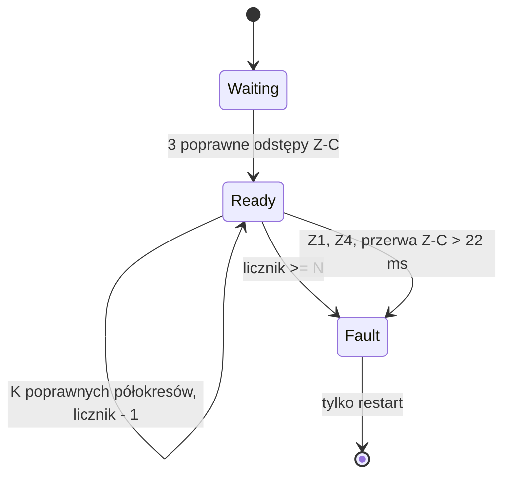

# Projekt: stopniowanie usterek fazowych

Status: **wdrożony w wersji v2.1** (`Phase.h` / `Phase.cpp` oraz testy `T14`/`T15` w `tests/core_test.cpp`).

## Stan obecny

`Phase` zatrzaskuje `fault_` przy każdym z poniższych zdarzeń. Zatrzask kasuje tylko `Phase::configure`, wywoływane wyłącznie w `driver::begin()`, czyli po restarcie. `Control::tick` przy `Drive::Fault` przechodzi do OFF. Robi to też przy każdym stanie innym niż `Ready` po pierwszej synchronizacji (`syncSeen_`).

| # | Zdarzenie | Miejsce | Czy impuls został wysłany | Skutek zdarzenia bez zatrzasku |
|---|---|---|---|---|
| Z1 | Zgoda wygasła (brak `publish` przez 30 ms) | `leaseValid`, `status` | Nie | Zadanie sterowania stoi. **Groźne** |
| Z2 | Odstęp Z-C > 11 ms przy aktywnej zgodzie | `edge`, `publish` | Nie, `cancel()` | Pominięty półokres, utrata synchronizacji |
| Z3 | Alarm spóźniony o > 100 µs | `alarm` | Nie, `timingFault()` | Pominięty półokres |
| Z4 | Koniec impulsu > 8700 µs po Z-C | `alarm` | Nie | Pominięty półokres |
| Z5 | Termin alarmu już minął przy programowaniu timera (`due <= now + 5`) | `applyAlarm` | Nie | Pominięty półokres |

Z2–Z5 kończą się **brakiem** impulsu. Bezpieczeństwo nie wymaga więc zatrzasku po pojedynczym zdarzeniu, a zatrzask zamienia jedno zakłócenie sieciowe w zatrzymanie wentylatora do restartu. Z1 oznacza zawieszenie logiki sterującej i musi zostać zatrzaskiem.

## Proponowane zasady

1. **Twarde, zatrzaskiwane natychmiast:** Z1, niepoprawny profil, Z4 przy poprawnym profilu. Z4 oznacza błąd obliczeń, a nie zakłócenie, bo `valid(profile)` gwarantuje `latestUs + gateUs <= 8600`.
2. **Miękkie, liczone:** Z2 (pojedynczy brakujący Z-C), Z3, Z5. Zdarzenie anuluje impuls w bieżącym półokresie i dodaje 1 do licznika.
3. **Zanik licznika:** −1 co `K` kolejnych poprawnych półokresów z impulsem.
4. **Zatrzask miękki:** licznik ≥ `N` daje `fault_ = true`, czyli ten sam stan co dziś (OFF, restart, świadomy wybór trybu).
5. **Pojedynczy brakujący Z-C:** odstęp w zakresie `[2 × minHalfUs, 2 × maxHalfUs]` (18–22 ms) zachowuje synchronizację (`intervals_` bez zmian) i liczy się jako zdarzenie miękkie. Dłuższa przerwa oznacza utratę sieci lub detektora i działa jak dziś: Z2 z zatrzaskiem.
6. **`Drive::Waiting` się nie zmienia.** Dzięki punktowi 5 krótki zanik Z-C nie wychodzi poza `Phase`, więc `Control` nie wymaga zmian. Reguła `syncSeen_ && drive != Ready → OFF` zostaje.

Wstępne wartości do weryfikacji w H02: `N = 4`, `K = 100` (1 s przy 50 Hz). Przy tych wartościach do zatrzymania potrzeba czterech zakłóceń w mniej więcej 4 s. Pojedyncze zakłócenia co kilka sekund nie zatrzymują wentylatora.

## Zmiany w kodzie (po H02)

- `Phase`: pola `softErrors_` i `cleanHalves_` (stan w DRAM, metody w IRAM, jak obecnie) oraz stałe `softLimit` i `decayHalves`. Getter `softErrors()` do diagnostyki.
- `Driver.cpp`: bez zmian logiki ISR. `applyAlarm` przy Z5 wywołuje nową metodę `Phase::lateAlarm()` zamiast `timingFault()`.
- Linia `diag`: dodane pole `soft=<licznik>` i licznik łączny od startu.
- `Inspect-Isr.ps1`: nowa metoda na liście funkcji wymaganych w IRAM.

## Testy hostowe do dodania

| Scenariusz | Oczekiwany wynik |
|---|---|
| Pojedynczy brak Z-C (odstęp 20 ms) | Brak impulsu w tym półokresie, `Ready`, licznik 1 |
| `N − 1` zdarzeń, potem `K × (N − 1)` czystych półokresów | Licznik 0, brak zatrzasku |
| `N` zdarzeń w krótkim czasie | `Fault`, `publish` zwraca `false` do `configure` |
| Przerwa Z-C 25 ms | `Fault` natychmiast (jak dziś) |
| Wygaśnięcie zgody | `Fault` natychmiast (jak dziś) |
| Alarm spóźniony o 101 µs | Brak impulsu, licznik + 1, bez zatrzasku |

## Pomiary H02 potrzebne do decyzji

1. Rozkład opóźnienia alarmu przy aktywnym BLE i odświeżaniu ekranu (maksimum z ≥ 10 min). Jeśli maksimum zbliża się do 100 µs, trzeba podnieść próg Z3 albo zmienić priorytet przerwania. Częstsze liczenie zdarzeń nie jest rozwiązaniem.
2. Liczba fałszywych i brakujących zboczy Z-C z silnikiem pod obciążeniem, w ciągu godziny.
3. Czy po pominiętym półokresie silnik wpada w słyszalne drgania. To decyduje, czy `N` może być większe.

